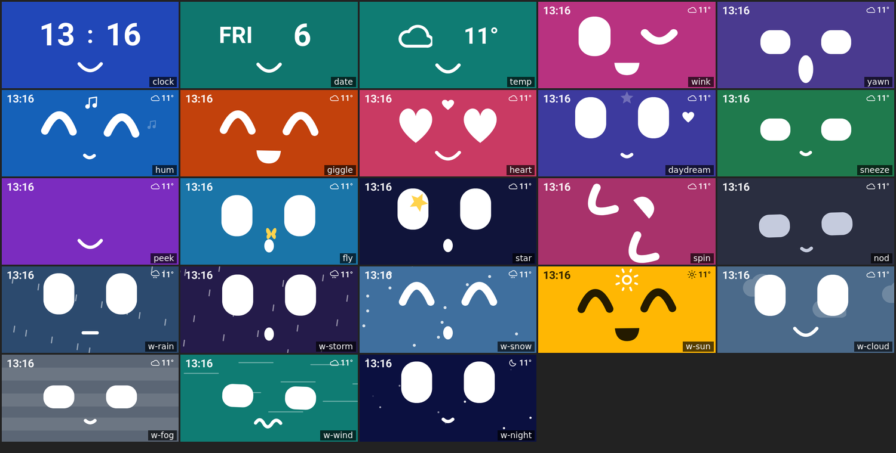
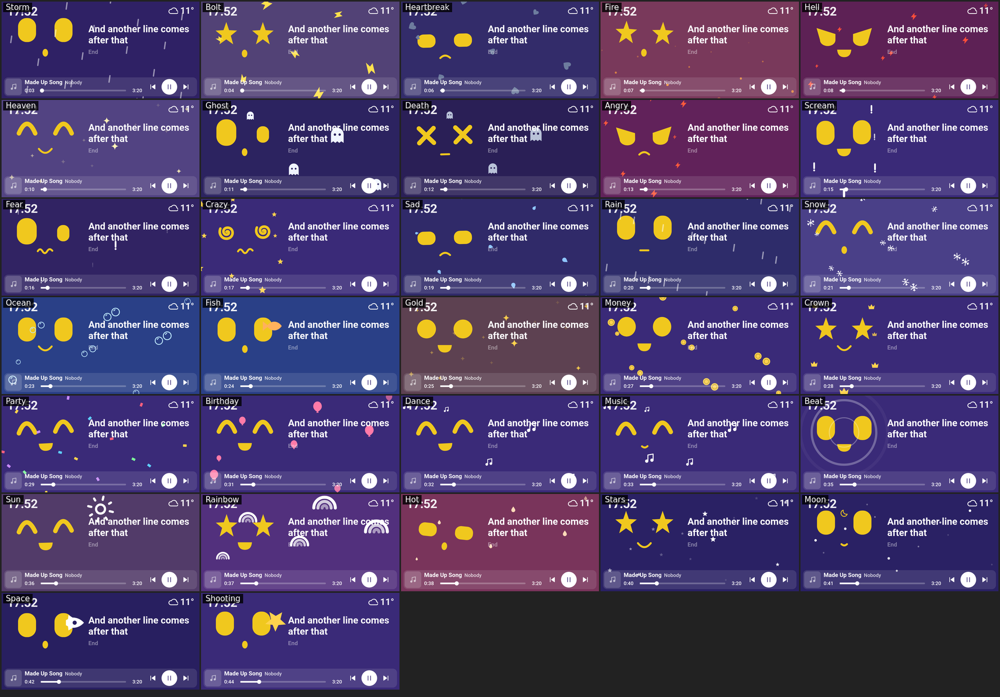

# Beepbot

A little robot face for a Home Assistant screen. It reacts when you talk to it, sings along to your music, counts down your timers, wakes you up gently and comes alive with hundreds of lyric trigger words. It was designed for an Echo Show 5 running Home Assistant.



## What it does

- **Reacts to your voice:** it listens, thinks and talks, with faces that match what you said.
- **Idle moments:** it winks, yawns, hums and shows the time, weather and what's coming up.
- **Now playing:** album cover, song title, progress and Previous, Play and Next buttons, with screen colours taken from the cover.
- **Karaoke lyrics:** synced lyrics, word by word where they're available, including for radio.
- **Lyric reactions:** 64 reactions and about 730 trigger words. Sing about rain and it rains; sing about money and coins fall.
- **Timers, reminders and alarms:** "remind me to take the bins out at 6", "wake me up at 7". Alarms can bring a light up slowly first.
- **Home events:** it greets people when they get home, notices the heating coming on, gets sleepy at bedtime and stretches in the morning.
- **One-tap menu:** lights (hold for brightness), heating, scenes, robot vacuums and the doorbell camera.
- **Robot Home:** a second card for an iPad or iPhone, with the robot and your home's controls.



## What you need

- **Home Assistant 2026.10 or newer**, with [HACS](https://hacs.xyz).
- **A screen showing a Home Assistant dashboard.** It was built and tested on a 960 by 470 screen with Chromium 118 or newer. Other screens may need adjusting.
- **A voice device in Home Assistant** (an "Assist satellite"). Without one, the robot just says "Voice is offline". For speech recognition and a voice, see [the voice and music guide](docs/VOICE-AND-MUSIC.md).

This guide doesn't cover turning an Echo Show into a Home Assistant screen.

Inside Home Assistant, Beepbot's files and settings still use its older name, `echo_robot` (and the card is `custom:echo-home-card`), so copies installed by hand before move over without losing anything.

## Install

Using an AI agent to set it up? Point it at [AGENTS.md](AGENTS.md).

1. In Home Assistant, open **HACS**, then the three-dot menu at the top right, then **Custom repositories**.
2. Paste `https://github.com/zephyrbyt/beepbot`, choose the type **Integration**, and press **Add**.
3. Search HACS for **Beepbot**, open it and press **Download**.
4. Restart Home Assistant (**Settings > System**, the power button at the top right, **Restart Home Assistant**).
5. Go to **Settings > Devices & services > Add integration** and choose **Beepbot**. Pick the voice device that should say reminders, and any wake-up lights, then **Submit**.
6. Make the dashboard: under **Settings > Dashboards**, add a new dashboard from scratch, open it, choose to edit it, then the three-dot menu and **Raw configuration editor**. Paste in [`examples/dashboard.yaml`](examples/dashboard.yaml) and replace every example with your own entity names (find them under **Developer Tools > States**).
7. Point your screen at the new dashboard and refresh it.

The integration adds the cards to your dashboards' resources by itself, so you don't need to add them by hand.

### Use an admin login on the screen

To show the words you said, the card reads Home Assistant's voice debug information, which only admins can read. On a non-admin login it still follows along, but it won't show your words or react to them as well.

## Updating

When there's a new version, HACS shows it under **Settings > Updates**. Press **Update**, then restart Home Assistant. The screens pick up the new card the next time they refresh (pull down from the top of an Echo, or restart its browser app).

[What changed in each version](https://github.com/zephyrbyt/beepbot/releases).

### What doesn't update itself

HACS updates everything inside Home Assistant's `custom_components/echo_robot` folder: the cards, timers and reminders, lyrics, photos and the spoken phrases. These are set up by hand, so they stay as they are until you change them:

| What | Where it lives | When to look at it |
|---|---|---|
| Your dashboard | Your own dashboard's raw configuration | Only if a release mentions a new setting you want. New settings are optional. |
| Scripts and automations for music, radio and weather (`assistant/`) | Pasted into Home Assistant | When a release says one changed: paste it again. |
| Chat assistant instructions (`assistant/grok-instructions.txt`) | Your conversation agent's settings | Same as above. |
| Speech recognition and voices (Whisper or Parakeet, Piper, Kokoro, the voice connector in `voice/`) | Your own server, often in Docker | Rarely. See [the voice and music guide](docs/VOICE-AND-MUSIC.md). |
| Settings changed on the screen itself (the cog in the tap menu) | That screen's browser | Never: they're yours. |

## Moving from a hand-installed copy (a zip)

Your dashboard, your reminders and alarms, and the settings you chose on the screen are all kept. Do these before step 3 of **Install** above:

1. In your Home Assistant config folder (the one holding `configuration.yaml`), delete these if they're there:
   - the folder `custom_components/echo_lyrics`
   - the folder `custom_components/echo_robot`
   - `custom_sentences/en/echo_speech.yaml`, `echo_reminders.yaml` and `echo_alarms.yaml` (the integration puts up-to-date copies there itself)
2. In `configuration.yaml`, delete the line `echo_lyrics:`. If there's an `echo_robot:` section, you can keep it (the integration then takes its settings from there, and you skip step 5 of **Install**) or delete it and use the settings page instead.
3. Carry on with **Install** from step 1. Skip step 6: your dashboard already uses the card.

The old card in **Settings > Dashboards > Resources** (`/local/echo-ui/echo-home-card.js`) is moved over to the new one by itself. Once everything works, you can delete the old file `www/echo-ui/echo-home-card.js`.

## Settings

The integration's own settings are under **Settings > Devices & services > Beepbot > Configure**: where reminders are said, wake-up lights, lyrics on or off, and which lyrics services to use. They apply after a restart.

The card's settings go in its section of your dashboard. [`examples/dashboard.yaml`](examples/dashboard.yaml) lists the main ones. A few more:

| Setting | What it does |
|---|---|
| `lyrics_offset` | Moves the lyrics earlier or later, in seconds, if they don't line up with the music |
| `moment_every` | Roughly how many seconds between idle moments (30 by default) |
| `spotify` | Which Spotify player to follow, if it doesn't find the right one by itself |

You can also turn most features off, including `moments`, `lyrics`, `lyric_reactions`, `album_colours`, `now_playing` and `home_events`. Many can also be changed on the screen itself, from the cog in the tap menu.

### Photos (optional)

An idle slideshow from one album in [Immich](https://immich.app) on your own network. Add this to `configuration.yaml` (it can't go on the settings page, because of the key), put the key in `secrets.yaml`, and restart:

```yaml
echo_robot:
  photos:
    album: Echo Show
    api_key: !secret echo_photos_immich_key
    url: http://127.0.0.1:2283
```

The key needs Immich's `album.read` and `asset.view` permissions. It stays in Home Assistant and never reaches the screen. An Immich address outside your home network is refused. With a `configuration.yaml` section, the other integration settings go there too (see the top of `custom_components/echo_robot/__init__.py`).

### Robot Home (iPad and iPhone)

Make another dashboard and paste in [`examples/robot-home.yaml`](examples/robot-home.yaml). It finds lights, heating, doorbells, music players and scenes by itself; add more with the cog.

## Add your own trigger words

Lyric reactions are all in one table called `REACTIONS` in `custom_components/echo_robot/www/echo-home-card.js`. Each line is a look, an effect and its trigger words, with the strongest themes first:

```js
['lyricMoney', { eye: 'coin', mouth: 'grin', anim: 'hop', fx: fall('coin', '#ffd34d', 14, 38), words: 'money cash dollar rich' }],
```

An update replaces that file, so send your additions as a pull request here if you'd like to keep them.

## Privacy

- **The cards** load nothing from the internet. They only talk to your Home Assistant.
- **Lyrics:** while music plays, Home Assistant sends the song's title, artist, album and length to lyrics services. **Open** uses only [LRCLIB](https://lrclib.net). **All** (the default) adds Better Lyrics, Apple Music lyrics through Paxsenix, and NetEase. Those aren't official services and could stop working at any time. Change it under **Configure**, or turn lyrics off there.
- **Radio lyrics** are lined up by listening to a few seconds of the station on your server and running them through your own speech recognition. Nothing heard is kept. To know how far behind live your speaker is, it reads your server's list of network connections.
- **Photos** only come from an Immich on your own network, and only admins can see them through Home Assistant.
- **Chat assistants:** if you use a cloud AI, what you say goes to that company as text.
- **Your dashboard** has the names of your people and devices in it. Don't share it here.

## Licence

[PolyForm Noncommercial 1.0.0](LICENSE): free for personal and other non-commercial use, and you can change it for your own home. Selling it or using it commercially isn't allowed. Improvements are welcome as pull requests to this repository.
